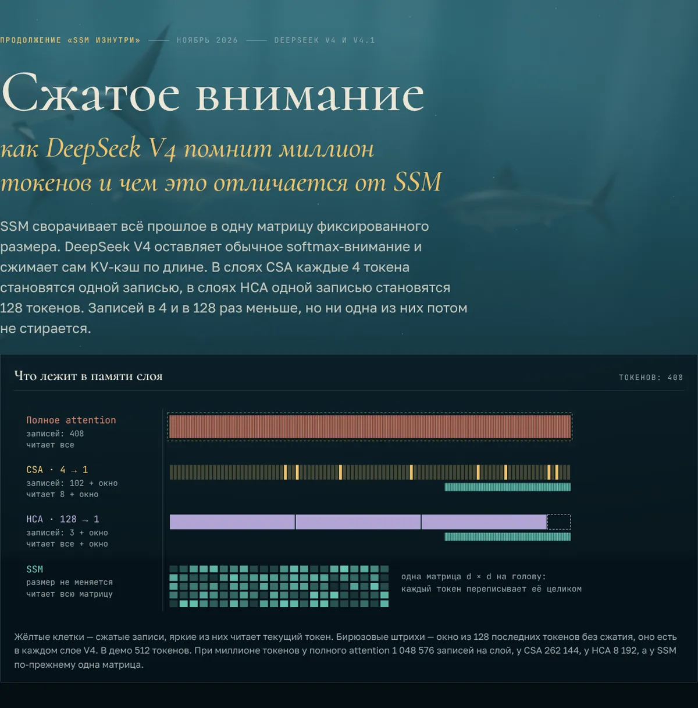
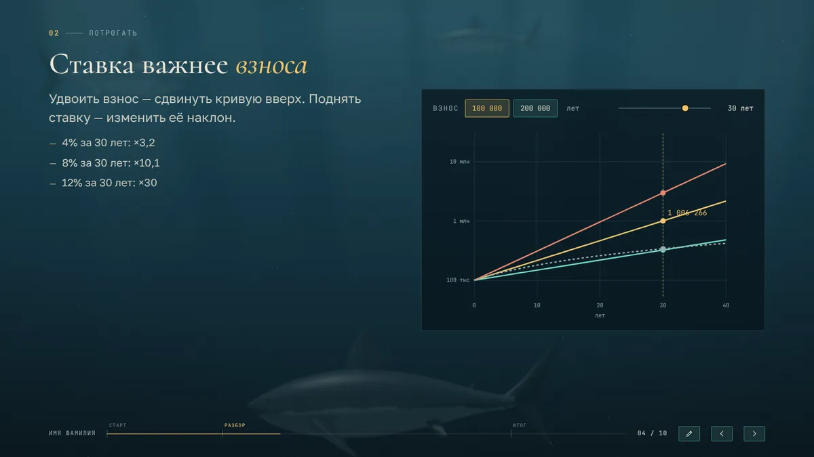
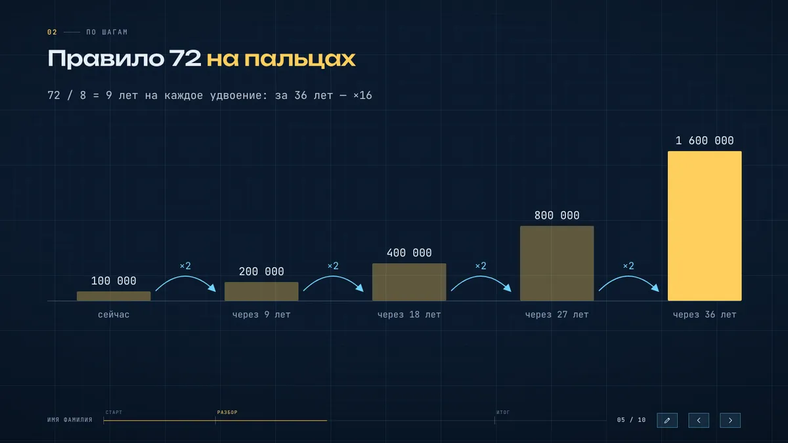
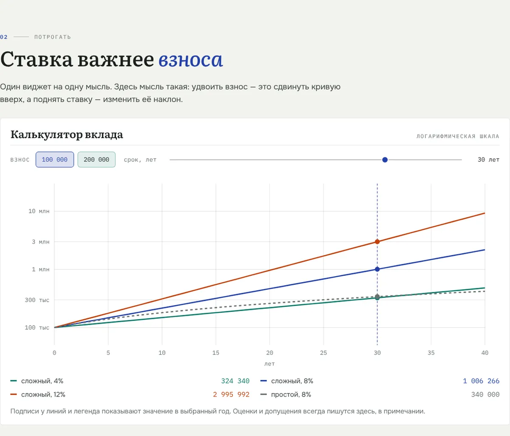
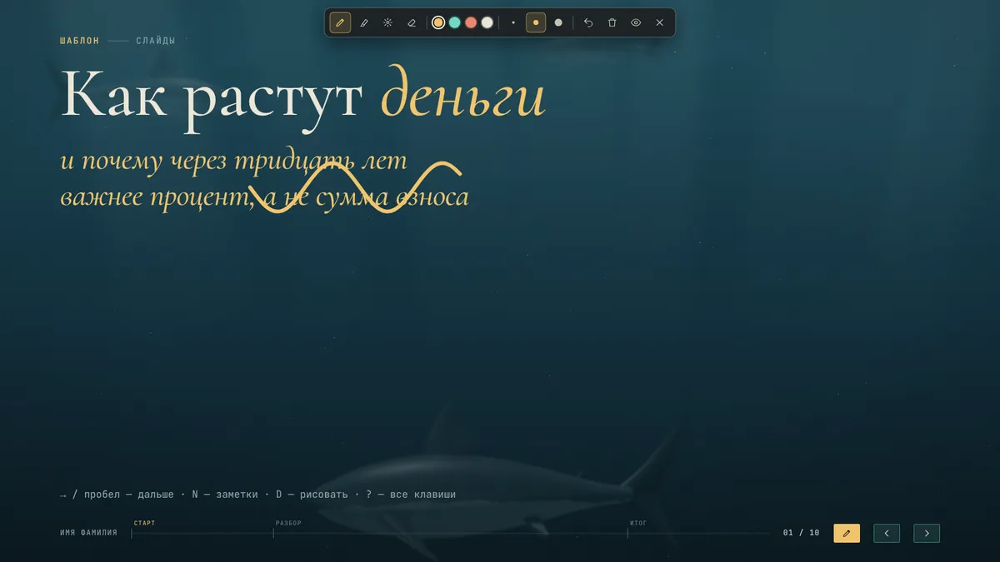

# explainer-kit

Скилл и кит для интерактивных объяснялок одним HTML-файлом. Один и тот же контент собирается в **лонгрид** или в **слайды**. В комплекте:
- живые схемы и калькуляторы;
- формулы, отрисованные заранее;
- три темы оформления;
- кнопка, чтобы рисовать прямо поверх страницы.



| | |
|---|---|
|  |  |
|  |  |

## Что умеет

- **Два формата из одного контента.**
  - `page` — оглавление, прогресс чтения, узкая колонка текста и широкие интерактивные плашки.
  - `deck` — сцена 1600×900, появление по клику, заметки докладчика, главы в прогресс-баре, переход по ссылкам между слайдами, свайпы.
- **Темы на токенах.**
  - `abyss` — тёмная вода с акулами и лучами света, вода темнеет по мере чтения.
  - `paper` — светлая бумага с ночным вариантом.
  - `blueprint` — инженерный чертёж с сеткой.

  Цвета, шрифты и фон меняются одной строкой в `config.json`. Своя тема — это папка с двумя файлами.
- **Рисование.** Перо, маркер, лазер (гаснет сам), ластик, цвета темы, отмена, очистка, скрытие. На слайдах у каждого слайда свой рисунок, на странице штрихи прокручиваются вместе с текстом. Включается кнопкой с пером или клавишей **D**.
- **Формулы.** `<m>…</m>` и `<M>…</M>` превращаются в SVG при сборке через MathJax. В браузере не нужно ничего грузить.
- **Хелперы для виджетов.** SVG-конструктор, графики на линейных и логарифмических шкалах, слайдеры, переключатели, анимации только в видимой области, числа в русской типографике.
- **Три вида сборки.**
  - Обычный HTML.
  - Фрагмент для артефакта claude.ai.
  - Один офлайн-файл: шрифты и картинки внутри, ноль сетевых запросов.
- **Проверка.** Скриншоты каждого раздела или слайда, отчёт о том, что вылезает за край, об ошибках консоли и мелком тексте, тест рисования.

## Установка

**Claude Code, как плагин:**

```text
/plugin marketplace add <путь к репозиторию или owner/explainer-kit на GitHub>
/plugin install explainer-kit@explainer-kit
```

**Claude Code, как личный скилл:** скопируйте `skills/explainer-kit` в `~/.claude/skills/`.

**claude.ai:** заархивируйте папку `skills/explainer-kit` в ZIP и загрузите как собственный навык.

После этого достаточно попросить, например: «сделай интерактивную страницу про KV-кэш» или «сделай слайды на 15 минут про бенчмарки». Скилл сам выберет формат, тему и пройдёт сборку с проверкой.

## Вручную, без Claude

```bash
cd skills/explainer-kit/kit && npm install            # MathJax и шрифты для офлайна
node new.mjs ../../../my-talk --format deck --theme blueprint --title "Мой доклад"
# правим my-talk/content.html и my-talk/widgets.js
node build.mjs ../../../my-talk                       # → my-talk/dist/index.html
node build.mjs ../../../my-talk --offline             # один файл без интернета
node check.mjs ../../../my-talk/dist/index.html --ink # скриншоты и отчёт (нужен playwright)
```

Для `check.mjs` нужен playwright: `npm i -D playwright && npx playwright install chromium`.

## config.json

```json
{
  "title": "Сжатое внимание DeepSeek",
  "description": "Одна фраза для превью",
  "lang": "ru",
  "format": "page",
  "theme": "abyss",
  "brand": "Сжатое <em>внимание</em>",
  "toc": true,
  "draw": true,
  "author": "Имя Фамилия",
  "chapters": { "0": "Старт", "1": "Разбор" },
  "tokens": { "--accent": "#f1c46c" },
  "tokensDark": {},
  "fonts": { "google": "https://fonts.googleapis.com/css2?…", "display": "\"…\", serif" },
  "ambient": "theme"
}
```

| поле | что задаёт |
|---|---|
| `format` | `page` или `deck` |
| `theme` | имя встроенной темы или путь к своей |
| `tokens`, `tokensDark` | переопределение токенов темы |
| `fonts` | свои шрифты |
| `ambient` | фон: `theme`, `ocean`, `grid`, `plain`, `none` или объект с настройками |
| `draw` | `false`, `true` или `{ "persist": true, "colors": [...] }` |
| `toc`, `brand` | только для лонгрида: оглавление и заголовок над ним |
| `author`, `chapters` | только для слайдов: подпись и главы в нижней панели |

## Структура

```text
.claude-plugin/            plugin.json и marketplace.json для Claude Code
skills/explainer-kit/
  SKILL.md                 порядок работы и главные правила
  reference/               design, page, deck, widgets, math, themes, drawing, checks
  kit/
    core/                  base/page/deck/draw.css, runtime/ambient/page/deck/draw.js
    themes/                abyss, paper, blueprint: theme.css + theme.json (+ assets)
    templates/             page и deck: рабочие шаблоны со всеми компонентами
    build.mjs new.mjs check.mjs
examples/
  compressed-attention/    настоящий разбор DeepSeek V4, перенесённый на кит без изменений текста
  money-page/              шаблон лонгрида в теме paper
  money-deck/              шаблон слайдов в теме abyss
docs/img/                  скриншоты для README
```

В каждой папке `examples/*/dist/index.html` лежит готовая сборка, её можно открыть в браузере.

## Лицензия

MIT. Шрифты распространяются по своим лицензиям (SIL Open Font License) и подключаются из Google Fonts или из пакетов @fontsource.
